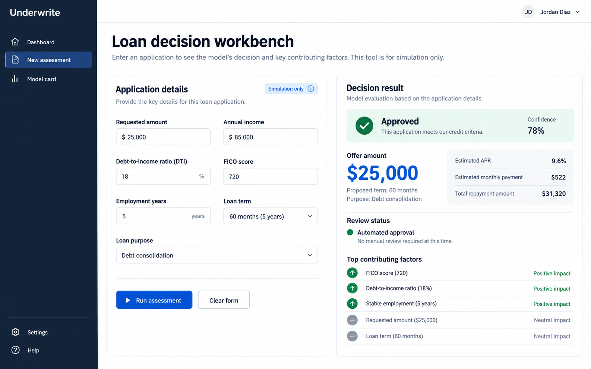

# Credence AI — Autonomous Credit Decision & Risk Intelligence Engine

An enterprise-grade, production-calibrated React + FastAPI credit underwriting engine with a documented machine-learning lifecycle. Stage 1 estimates calibrated repayment probability with native TreeSHAP attributions and regulatory monotonic constraints. Stage 2 estimates historical capacity and enforces transparent regulatory affordability caps (RBI 50% FOIR / CFPB 43% DTI).



*Design concept; the live interface is implemented in `frontend/`.*

## Measured results

### Lending Club Benchmark (Temporal Split, Jul 2016–Nov 2018)
| Evaluation | Result |
| --- | ---: |
| Future-period ROC AUC (93,607 labeled loans) | **0.8012** (bootstrap 95% interval 0.7977–0.8045) |
| Future-period average precision | **0.9487** (positive class prevalence 0.8424) |
| Future-period Brier score | **0.1064** |
| Historical amount MAE | **$5,455** (median baseline $7,368) |

### Home Credit Relational Benchmark (Multi-Table with Reject Inference)
| Evaluation | Result |
| --- | ---: |
| Validation ROC-AUC (61,503 loans, 307,511 total) | **0.7541** |
| Validation PR-AUC (imbalanced default target 8.07%) | **0.2404** |
| Validation Brier score | **0.0680** |
| Multi-table feature count | **36 relational features** (Bureau & Previous App history) |

---

## Architecture & Enterprise Stack

- **Dual-Market Underwriting**: Seamless switching between **INR (`₹`)** (CIBIL 300–900, RBI 50% FOIR cap, Key Fact Statement (KFS) with 18% GST breakdown) and **USD (`$`)** (FICO 300–850, 43% DTI ceiling, Reg Z TILA APR).
- **Explainability & Fair Lending**: Exact **TreeSHAP** marginal attributions (`pred_contrib=True`), prescriptive counterfactual recourse suggestions, and live ECOA / RBI demographic parity checks.
- **Persistent Data & Drift Monitoring**: Dual-engine persistence (PostgreSQL with automatic SQLite fallback) logging every evaluation with real-time Population Stability Index (PSI) baseline comparisons.
- **Enterprise Caching & Rate Limiting**: Redis sliding-window rate limiting (100 req/min) and 10-minute memoized assessment caching with graceful in-memory fallbacks.
- **Expanded 5-Tab Workbench**:
  1. **Executive Dashboard**: Live portfolio audit trail, approval ratios, and aggregate metrics.
  2. **Underwriting Workbench**: Real-time dual-currency application evaluator with KFS breakdown, SHAP drivers, and counterfactuals.
  3. **Portfolio Stress Testing**: Macroeconomic shock simulator (repo rate spikes, inflation shock, CAR buffer stress).
  4. **Explainability & Audit Center**: Feature importance rankings, regulatory compliance, and live PSI feature drift monitor.
  5. **Model Card & Governance**: Model architecture, calibration curves, training boundaries, and bias disclosures.

---

## Run Locally

### Option A: Local Dev (Zero external dependencies)
Python 3.11+ and Node 20+ are recommended.

```bash
# 1. Start Backend (SQLite & in-memory cache fallback enabled automatically)
python -m venv .venv
source .venv/bin/activate
pip install -r requirements.txt
python -m uvicorn backend.app.main:app --reload --port 8000
```

In another terminal:
```bash
# 2. Start Frontend
cd frontend
npm ci
npm run dev
```

Open **http://localhost:5173** (API Swagger at **http://localhost:8000/docs**).

### Option B: Docker Compose (Full Enterprise Stack)
Includes PostgreSQL 16, Redis 7, FastAPI backend, and Nginx-served React frontend:

```bash
docker compose up --build
```

---

## Verification & Tests

```bash
# Run pytest verification suite (13 passing tests)
pytest -v

# Run frontend build & TypeScript checks
cd frontend && npm run build && npx tsc --noEmit
```
