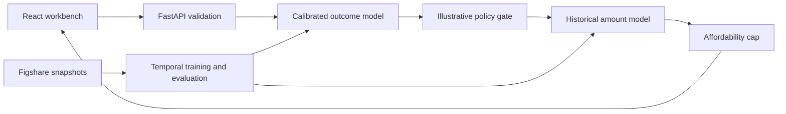

# Underwrite — two-stage loan research simulator

A resume-ready React + FastAPI project with a documented machine-learning lifecycle. Stage 1 estimates a favorable loan outcome in a historical funded-loan cohort. Stage 2 estimates the typical historical amount for a similar funded loan, then applies a transparent affordability cap. **It is a research simulation, not an actual lender approval or optimal loan offer.**

## Measured results

| Evaluation | Result |
| --- | ---: |
| Future-period ROC AUC (Jul 2016–Nov 2018, 93,607 labeled loans) | **0.8012** (bootstrap 95% interval 0.7977–0.8045) |
| Future-period average precision | **0.9487** (positive class prevalence 0.8424) |
| Future-period Brier score | **0.1064** |
| Historical amount MAE | **$5,455** (median baseline $7,368) |
| Earlier Apr–Jun 2016 temporal check ROC AUC | **0.7518** |

Results vary by year: ROC AUC 0.8082 (2016), 0.8008 (2017), 0.7894 (2018). These scores measure prediction of a **derived, incompletely documented** `loan_status` encoding among previously funded loans. They do not measure approval decisions, fairness, profitability, or effectiveness of the simulated offer.

## Run locally

Python 3.11+ and Node 20+ are recommended.

```bash
python -m venv .venv
source .venv/bin/activate
pip install -r requirements.txt
python scripts/download_data.py
python -m backend.ml.train
python -m uvicorn backend.app.main:app --reload --port 8000
```

In another terminal:

```bash
cd frontend
npm ci
npm run dev
```

Open http://127.0.0.1:5173. API docs: http://127.0.0.1:8000/docs. The trained `models/bundle.joblib` is included for immediate inference; the raw CSVs are downloaded and checksum-verified for reproducible training. To run checks: `python -m pytest backend/tests -q`, then `cd frontend && npm run build && npx tsc --noEmit`.

## System and data flow



The training snapshot contains 236,846 funded loans from 2014–June 2016. Fit: 2014–15; model selection: Jan–Feb 2016; calibration: March 2016; internal check: April–June 2016. The separate source test file contains 93,607 usable future-period labeled loans from July 2016–November 2018. The code filters missing targets and reports counts. Only application-time features are used; grade, interest rate, installment and repayment outcomes are excluded from predictors. Amount is excluded from the amount regressor's predictors.

The UI asks for 12 scenario fields, including income, DTI, FICO, requested amount and credit profile. Its example values are prefilled for exploration and must be changed for a real scenario. A 0.70 threshold and 12% APR are illustrative policy assumptions, not learned pricing or a lender's criteria.

## Project structure

- `docs/PRD.md`: product goals, flow and acceptance criteria
- `docs/TRD.md`: architecture, API, training and deployment design
- `docs/DATA.md`: dataset provenance, audit and limitations
- `docs/schema.sql`: future persistence design; current demo stores no applications
- `notebooks/01_exploration.ipynb`: reproducible EDA and training walkthrough
- `backend/ml/`: source normalization, candidate selection, calibration and evaluation
- `backend/app/`: validation, two-stage inference and illustrative policy
- `frontend/`: responsive React/Vite interface
- `models/metrics.json`: complete measured metrics and per-year drift

## Responsible interpretation and next milestone

The source is a modified Lending Club snapshot with no actual rejected applications or original requested-versus-funded offer pair. The favorable meaning of label 1 is inferred from source distributions, not validated by a codebook. Funded-only selection bias and potential outcome maturity/censoring remain. The app's scenario sensitivity is a simple one-variable probe and **not** an adverse-action explanation. A genuine lending system would need verified target semantics, observed application and offer labels, fairness assessment, accurate denial reasons, human review, security controls and prospective validation.
