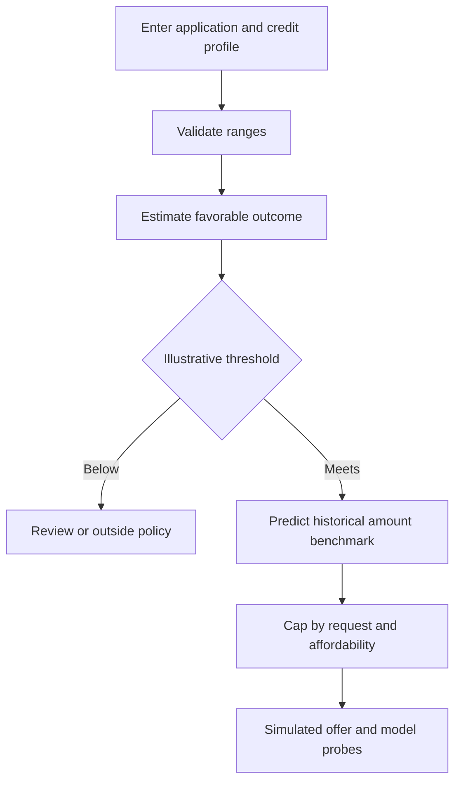

# Product requirements — Underwrite v0.2

## Intent

A portfolio research app for hiring reviewers and ML learners to inspect a real data pipeline, model evaluation and two-stage simulation. Its interface must explain the difference between historical funded-loan outcomes and actual approval decisions.

## User flow

## Functional requirements

- A responsive React workbench with 12 labeled inputs: requested amount, annual income, DTI, FICO, employment years, 36/60-month term, purpose, revolving credit utilization, open accounts, public bankruptcies, revolving balance and home ownership. Prefilled example values are explicitly labeled.
- Browser and API range validation. Unsupported categories return 422; missing model returns 503. No applicant data is persisted.
- The result shows the funded-cohort favorable-outcome estimate, nullable simulated offer, historical amount benchmark, affordability cap, assumed APR and illustrative payment.
- Scenario sensitivity shows one-input reference probes and disclaims that they are not legal denial reasons.
- Model card shows measured out-of-time AUC with uncertainty interval, average precision, Brier, amount MAE and limitations. Dashboard summarizes data partitions.

## Acceptance criteria

1. Valid input returns a real API result; no result is hard-coded in React.
2. Amount never exceeds request, benchmark, affordability cap or $40,000; high DTI yields no offer.
3. Missing or out-of-range credit fields return HTTP 422.
4. Model selection and calibration occur before the future-period test file; metrics are reproduced from checksummed snapshots.
5. Desktop and mobile layouts retain readable labels, feedback and keyboard operation.
6. Application records are neither logged nor stored by the demo API.

## Non-goals

No real credit approval, individualized financial advice, APR quote, production underwriting, fairness certification or regulatory adverse-action notice.
